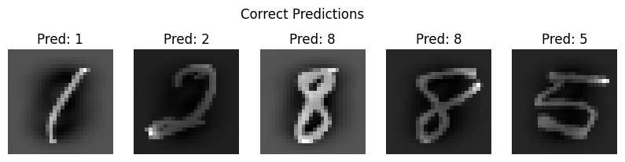
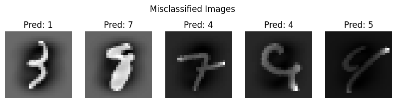

# MNIST Classification Using Least Squares

A course-assignment exercise that implements a one-vs-rest least-squares classifier for handwritten digit recognition on MNIST. It reports the original notebook's training/test results and discusses the limitations of a linear least-squares model.

**Notebook:** [Open the original assignment notebook](https://github.com/sachin2967/least-squares-mnist/blob/main/LAAIML24_21CE3AI15_MNIST__Assignment.ipynb).

> **Academic and licensing note:** this repository includes an assignment-named notebook. Check applicable course rules before redistribution. No open-source licence is specified, so all rights remain with the respective copyright holders.

---

## Features  
- **Dataset:** MNIST handwritten digits dataset fetched using `scikit-learn`.  
- **Model:** Least Squares Classifier implemented using `numpy.linalg.lstsq`.  
- **Evaluation Metrics:** Training and test accuracy, along with analysis of misclassified examples.  
- **Visualization:** Displays correctly classified and misclassified images for better interpretability.  

---
## Results Summary  

- **Training Accuracy:** 85.9%  
- **Test Accuracy:** 85.4%  

### Visualizations:  
1. Correctly classified images:  
     

2. Misclassified images:  
     

---

## Explanation  

### **1. Training and Test Accuracy Results**  
- **Training Accuracy:** 85.9%  
- **Test Accuracy:** 85.4%  

The model performs moderately well but struggles with certain complexities in the dataset.

---

### **2. Discussion of Misclassified Examples**  
Misclassifications occur due to:  
1. **Similar Digit Structures:** e.g., '9' misclassified as '4'.  
2. **Diverse Handwriting Styles:** e.g., '8' misclassified as '7'.  
3. **Noise in Images:** Faint strokes or extra pixels confuse the model.  
4. **Linear Model Limitations:** Cannot capture non-linear patterns.  
5. **Global Weight Matrix Constraint:** Lacks flexibility for local variations.

---

### **3. Why Least Squares Performs Worse on MNIST**  
1. **Linear Boundaries:** Cannot handle MNIST’s complex patterns.  
2. **Limited Flexibility:** Struggles with diverse handwriting styles.  
3. **Sensitive to Noise/Outliers:** Noisy data impacts predictions significantly.  
4. **Overfitting to Outliers:** May overfit mislabeled or noisy examples.  
5. **No Feature Learning:** Does not learn abstract features like curves or edges.

These limitations make it less effective compared to non-linear models like SVMs or neural networks.

---

